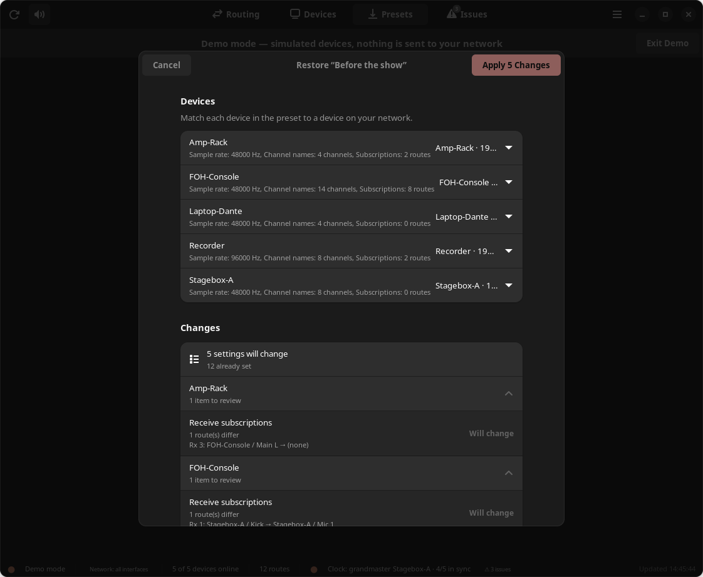
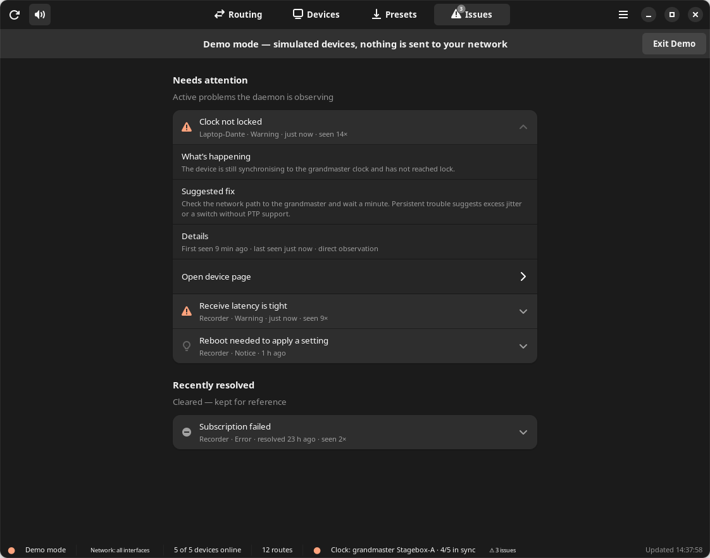
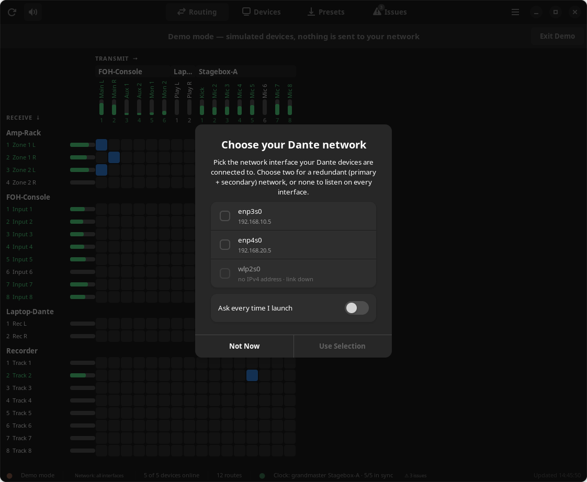
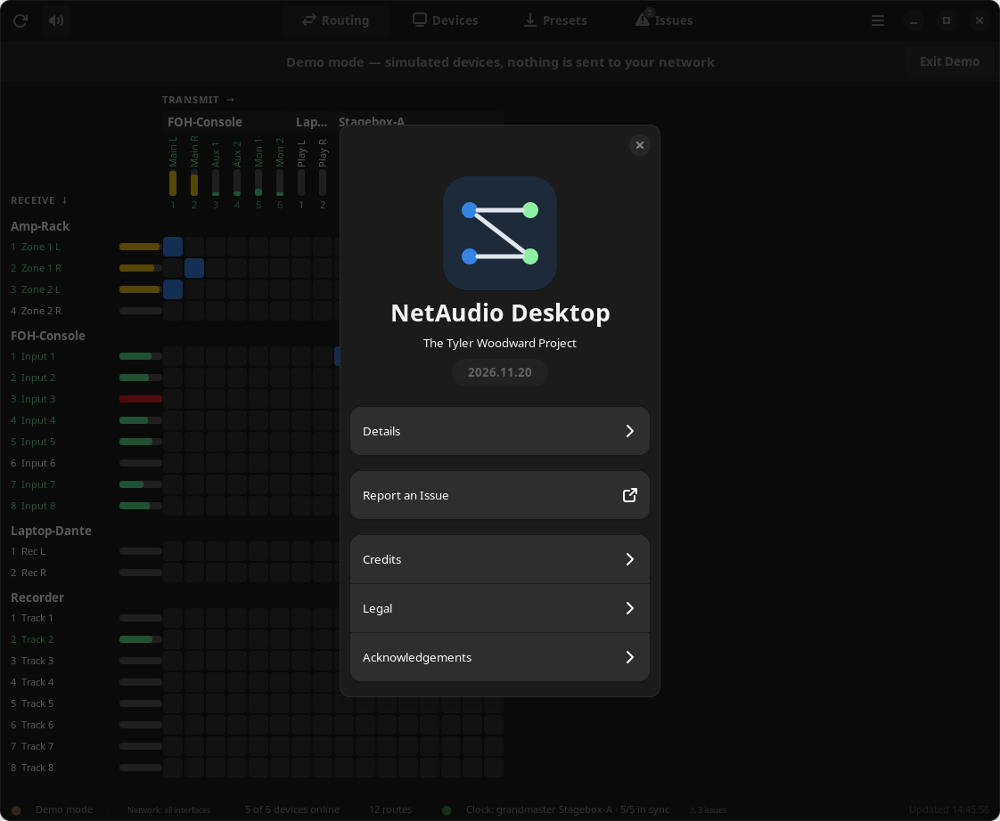

<div align="center">


# NetAudio Desktop

**A native Linux desktop app for Dante audio networks.**<br>
Discover devices, patch channels in a routing matrix, watch levels and clock sync, save and restore whole setups — in a clean GNOME-style window.

[](https://github.com/thetylerwoodwardproject/netaudio-desktop/releases)
[](https://github.com/thetylerwoodwardproject/netaudio-desktop/actions)
[](LICENSE)


[**Download**](https://github.com/thetylerwoodwardproject/netaudio-desktop/releases) ·
[Features](#-features) ·
[Screenshots](#-screenshots) ·
[Install](#-install) ·
[Try demo mode](#-try-it-without-any-hardware) ·
[Credits](#-credits)

<br>


</div>

> **Unofficial.** NetAudio Desktop is a front end for the open-source [NetAudio](https://netaudio.app/linux) daemon
> ([chris-ritsen/network-audio-controller](https://github.com/chris-ritsen/network-audio-controller)).
> It is not affiliated with or endorsed by Audinate. “Dante” is a registered trademark of Audinate Pty Ltd.

---

## ✨ Features

| | |
|---|---|
| 🔀 **Routing matrix** | Receivers as rows, transmitters as columns, with channel names on both axes (transmit names read vertically above each column). Click a cell to patch, click again to clear. A hover crosshair shows exactly which row and column you're about to change. |
| ✏️ **Rename anywhere** | Click a channel label in the matrix, or edit names on the device page. Click a device name to jump to its page. |
| 🎚️ **Live meters** | One button turns on level bars for every channel. Names turn green when **audio is present**; bars go amber when hot and red on clipping. Opt-in, because it asks devices to stream meter data. |
| 🕒 **Clock & sync** | Each device's clock role, sync state, frequency offset and drift; **who the grandmaster is** and who each device syncs to; per-port status; a **Preferred leader** switch. Overall health lives in the status bar. |
| 🎛️ **Audio settings & gain** | Sample rate, bit depth, receive latency and pull-up from the choices each device advertises, plus per-channel **reference-level (gain)** dropdowns on devices that have them. Anything that can interrupt audio asks first. |
| 💾 **Presets** | Save routing, channel names, audio settings and device controls — and restore them later. A restore **always shows a plan first**: what will change, what already matches, what can't be applied. Nothing is written until you confirm. Presets are plain XML you can export, import and share. |
| ⚠️ **Issues** | An **Issues** tab (badge + status-bar chip) lists what the daemon is flagging — clock not locked, tight receive latency, failed subscriptions, reboot needed — with a suggested fix and a link to the device. |
| 🌐 **Pick your Dante network** | On first launch (with more than one network interface) the app asks which one your devices are on — or two, for a redundant network. Change it any time from the status bar. |
| 🧪 **Demo mode** | No Dante gear? Flip on **Demo mode** for a fully interactive simulated network, including presets, meters and issues. |
| 🚀 **Zero setup** | Starts the NetAudio daemon for you if it isn't already running. |

## 📸 Screenshots

<table>
<tr>
<td width="50%" align="center"><br><sub><b>Devices</b> — info, audio settings, clock &amp; sync, per-channel names and gain</sub></td>
<td width="50%" align="center"><br><sub><b>Presets</b> — review exactly what a restore will change before applying</sub></td>
</tr>
<tr>
<td align="center"><br><sub><b>Issues</b> — what's wrong, why, and what to try</sub></td>
<td align="center"><br><sub><b>Network</b> — choose the interface your Dante devices are on</sub></td>
</tr>
<tr>
<td colspan="2" align="center"><br><sub><b>About</b> — credits, acknowledgements and legal notices</sub></td>
</tr>
</table>

## 📦 Install

Requires **Ubuntu 24.04 or newer** (or any distro with GTK 4 and **libadwaita 1.5+**) and Python 3.10+.
Connect the computer to the network your Dante devices are on. A Dante PCIe card is **not** required for device control.

> **Latest release: [`v2026.11.21`](https://github.com/thetylerwoodwardproject/netaudio-desktop/releases/latest)** — includes everything
> described here (live meters, presets, Issues, audio settings & gain, the network-interface picker, credits). Download the
> `.deb`, snap or wheel from the release page, or run from source below.

### From source

```bash
git clone https://github.com/thetylerwoodwardproject/netaudio-desktop
cd netaudio-desktop
sudo apt install python3-gi gir1.2-gtk-4.0 gir1.2-adw-1
uv tool install netaudio          # the daemon — see below
./install.sh                      # adds “NetAudio” to your app menu (optional)
./netaudio-desktop                # or just run it in place
```

### Debian / Ubuntu (`.deb`)

```bash
sudo apt install ./netaudio-desktop_*_all.deb
uv tool install netaudio          # the daemon is installed separately
```

### Snap (bundles the daemon)

```bash
sudo snap install --dangerous ./netaudio-desktop_*.snap
```

<details>
<summary><b>Installing the daemon</b></summary>

NetAudio Desktop is a front end; the Dante protocol work is done by the
[`netaudio`](https://netaudio.app/linux) daemon. Install it with [uv](https://docs.astral.sh/uv/):

```bash
curl -LsSf https://astral.sh/uv/install.sh | sh    # if you don't have uv yet
uv tool install netaudio
```

The app finds and starts `netaudio-daemon` for you. If you already run a daemon, it connects to that one
(default port `4780`, configurable in Preferences).
</details>

## 🚀 Quick start

1. Launch **NetAudio** from your app menu (or `./netaudio-desktop`).
2. If asked, pick the network interface your Dante devices are connected to.
3. The **Routing** tab fills with your devices. Click a cell to patch a transmitter into a receiver.
4. Press the 🔊 button for live meters; open **Devices** for clock sync, audio settings and gain.
5. On **Presets**, save the setup you like. Restore it any time — you'll see the plan before anything changes.

## 🧪 Try it without any hardware

Open the main menu (☰) → **Demo mode**, or press **Try Demo Mode** on the empty screen.
You get five simulated devices with routes, a live clock, meters and a few issues. Route channels,
rename things, move the grandmaster, save a preset, scramble the setup and restore it. Nothing touches your network.

```bash
netaudio-desktop --demo        # launch straight into it
```

## ⌨️ Keyboard shortcuts

| Keys | Action | Keys | Action |
|---|---|---|---|
| `Ctrl+1` | Routing | `Ctrl+4` | Issues |
| `Ctrl+2` | Devices | `Ctrl+M` | Toggle meters |
| `Ctrl+3` | Presets | `Ctrl+F` | Search devices |
| `F5` | Rescan the network | `Ctrl+Q` | Quit |

## 🛡️ Safety

NetAudio Desktop controls live audio gear, so it is conservative by default:

- **Presets never apply blindly.** Capture only reads. Restore builds a read-only plan first, and the daemon refuses an
  apply whose plan is stale. You confirm explicitly.
- **Disruptive changes ask first** — sample rate, bit depth, latency, pull-up — and cancelling restores the control.
- **Locked devices** have their controls disabled.
- **Meters are opt-in**, and the app tells devices to stop when you switch them off or close the window.
- **Demo mode never touches your network** and uses its own in-memory presets.

## 🔧 How it works

```
 NetAudio Desktop (GTK4 / libadwaita)
          │  HTTP + JSON, and a live event stream  (127.0.0.1:4780)
          ▼
   netaudio daemon  ──►  Dante devices on your LAN
```

The app talks only to the daemon's documented local HTTP API, using the Python standard library for networking,
and does all requests off the main thread so the UI stays responsive.

| Feature | Daemon API |
|---|---|
| Devices, routing, names | `/devices` · `/subscribe` · `/unsubscribe` · `/rename-device` · `/rename-channel` · `/identify` |
| Clock & sync | `clock_status` in `/devices` · `/set-preferred-leader` |
| Meters & signal presence | `/events` (`meter_values`) · `/metering/start` · `/metering/stop` |
| Audio settings & gain | `/set-sample-rate` · `/set-encoding` · `/set-latency` · `/set-sample-rate-pullup` · `/set-gain` |
| Presets | `/presets/save` · `/presets/preview` · `/presets/plan` · `/presets/load` |
| Issues | `/issues` |
| Network interface | `/settings` · `/settings/network` |

**Your files:** settings in `~/.config/netaudio-desktop/config.json`; presets in
`~/.local/share/netaudio-desktop/presets/` (one `.xml` plus a small `.json` sidecar each).

## 🩹 Troubleshooting

- **The app icon doesn't show on COSMIC / Pop!_OS** (generic icon in the dock or app list): re-run `./install.sh`.
  COSMIC ignores a per-user icon folder that has no `index.theme`; the installer now creates one and points the launcher
  at the icon by path. If the panel still shows a stale icon, log out and back in (or restart the panel) so it re-reads the
  launcher.
- **"Cannot reach daemon":** install it with `uv tool install netaudio`, or check the port in Preferences (default `4780`).
- **No devices appear:** make sure this computer is on the Dante network, and pick the right interface from the
  status bar (☰ → *Network interface…*). Try **Demo mode** to confirm the app itself is fine.

## 🛠️ Building packages

| Package | Command |
|---|---|
| `.deb` | `./packaging/build-deb.sh` → `dist/` |
| Python wheel / sdist | `python -m build` |
| Snap | `snapcraft` |

Pushing a tag like `v2026.11.20` runs [the release workflow](.github/workflows/release.yml), which builds all three and
attaches them to a GitHub Release. Versions are calendar-based: `YYYY.MM.DD`.

<details>
<summary><b>Project layout</b></summary>

```
netaudio_desktop/
  app.py          main window, routing matrix, device pages, status bar
  api.py          thin client for the daemon's HTTP API (stdlib only)
  meters.py       meter_values event-stream reader + demo simulator
  clock.py        grandmaster / sync-health interpretation
  devsettings.py  latency, rate, pull-up and gain helpers
  presets.py      preset storage and plan helpers (no GTK)
  presets_ui.py   Presets tab: save and restore dialogs
  issues_ui.py    Issues tab
  demo.py         in-memory simulator used by demo mode
data/             icon, desktop entry, appstream metadata
packaging/        .deb builder · snap/ snapcraft.yaml · .github/ release workflow
```
</details>

## ⚠️ Status

This project is young. It is built against the daemon's published API and exercised against a built-in simulator
and mock daemons, but **it has not yet been tested on a real Dante network**. Expect rough edges —
particularly clock-health colouring (which interprets the daemon's status text heuristically; the raw values are always
shown beside it), device-ID handling in presets, and how real devices report gain and latency choices.
There is no automated test suite yet.

**Hardware feedback is very welcome.** If you have Dante gear, please
[open an issue](https://github.com/thetylerwoodwardproject/netaudio-desktop/issues) with what you tried and what you saw
(the device models help a lot).

### Ideas for later

Host-audio view (JACK/PulseAudio ↔ Dante), AES67 / external flows, transmit-flow editing, full clock configuration,
bulk routing selection, Dante Domain Manager awareness.

## 🙏 Credits

- **[NetAudio](https://netaudio.app/linux)** by [chris-ritsen](https://github.com/chris-ritsen/network-audio-controller) —
  the daemon, API and all of the Dante protocol work this app is built on. None of this exists without it. Go star it.
- **Dante** and **[Audinate](https://www.getdante.com)** — the audio-over-IP technology that makes networked audio
  practical. Dante® is a registered trademark of Audinate Pty Ltd.
- **Made with the help of machines.** This project was designed and written with the help of AI
  ([Claude](https://www.anthropic.com), by Anthropic), under human direction and review.
- **[The Tyler Woodward Project](https://tylerwoodward.me)** — direction, testing and the app itself.
- Built with [GTK 4](https://www.gtk.org), [libadwaita](https://gnome.pages.gitlab.gnome.org/libadwaita/) and
  [PyGObject](https://pygobject.gnome.org).

## 📄 License

[MIT](LICENSE). The `netaudio` daemon is a separate project released into the public domain under the
[Unlicense](https://unlicense.org).
