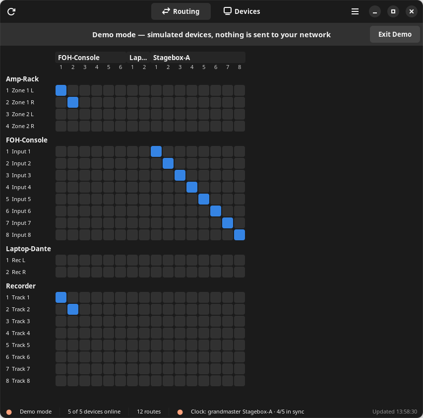
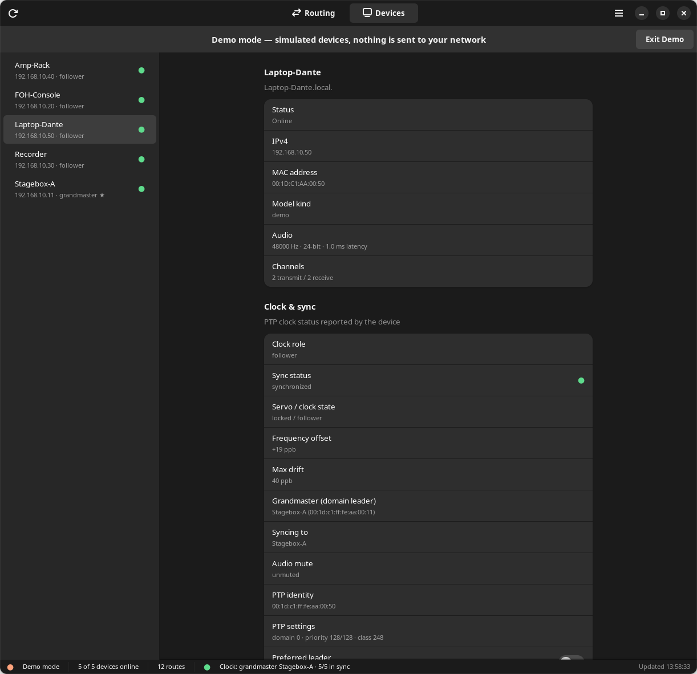

<div align="center">


# NetAudio Desktop

**A native Linux desktop app for Dante audio networks.**<br>
Discover devices, patch channels in a routing matrix, and keep an eye on clock sync — all from a clean GNOME-style window.

[](https://github.com/thetylerwoodwardproject/netaudio-desktop/releases)
[](LICENSE)




</div>

> **Unofficial.** Built on the open-source [NetAudio](https://netaudio.app/linux) daemon
> ([chris-ritsen/network-audio-controller](https://github.com/chris-ritsen/network-audio-controller)).
> Not affiliated with or endorsed by Audinate. “Dante” is a trademark of Audinate Pty Ltd.

---

## ✨ Features

| | |
|---|---|
| 🔀 **Routing matrix** | Receivers as rows, transmitters as columns. Click a cell to subscribe, click again to clear. One source per receive channel, kept in sync with the network every few seconds. |
| ✏️ **Rename in place** | Click a receive channel name (row) or a transmit channel number (column header) to rename it right from the matrix. |
| 🕒 **Clock & sync** | See each device’s clock role, sync state, frequency offset, drift, **who the grandmaster is** and who each device syncs to, plus per-port status. Toggle **Preferred leader** from the app. |
| 📟 **Device details** | IP/MAC, sample rate, encoding, latency, channel counts. Rename devices, change sample rate, or flash a device’s identify light. |
| 📊 **Status bar** | Daemon connection, devices online, route count and overall clock health (`grandmaster Stagebox-A · 5/5 in sync`) at a glance. |
| 🧪 **Demo mode** | No Dante gear? Flip on **Demo mode** for a fully interactive simulated network. |
| 🚀 **Zero setup** | Starts the NetAudio daemon for you if it isn’t already running. |

<div align="center">

</div>

## 📦 Install

Download the latest package from the [Releases page](https://github.com/thetylerwoodwardproject/netaudio-desktop/releases).

### Debian / Ubuntu (`.deb`)

```bash
sudo apt install ./netaudio-desktop_*_all.deb
uv tool install netaudio          # provides the netaudio daemon (see below)
```

### Snap (bundles the daemon)

```bash
sudo snap install --dangerous ./netaudio-desktop_*.snap
```

### From source

```bash
git clone https://github.com/thetylerwoodwardproject/netaudio-desktop
cd netaudio-desktop
sudo apt install python3-gi gir1.2-gtk-4.0 gir1.2-adw-1
uv tool install netaudio          # the daemon
./install.sh                      # adds “NetAudio” to your app menu
# …or just run it in place:
./netaudio-desktop
```

<details>
<summary><b>Installing the daemon</b></summary>

NetAudio Desktop is a front end; the Dante protocol work is done by the
[`netaudio`](https://netaudio.app/linux) daemon. Install it with [uv](https://docs.astral.sh/uv/):

```bash
curl -LsSf https://astral.sh/uv/install.sh | sh    # if you don't have uv yet
uv tool install netaudio
```

Connect the computer to the network your Dante devices are on. A Dante PCIe card is **not** required for device control.
</details>

## 🧪 Try it without any hardware

Open the main menu (☰) → **Demo mode**, or press **Try Demo Mode** on the empty screen.
You get five simulated devices with routes and a live clock — route channels, rename things,
change the grandmaster. Nothing touches your network. Launch straight into it with:

```bash
netaudio-desktop --demo
```

## 🖱️ Using it

- **Routing** — click a cell to patch, click a lit cell to unpatch. Hover headers for full channel names.
- **Rename channels** — click a channel label in the matrix, or edit it on the **Devices** page.
- **Devices** — pick a device on the left for details, clock & sync, and settings.
- **Rescan** — `F5` or the ↻ button.
- **Preferences** — daemon port (default `4780`) and auto-start, in the ☰ menu.

## 🔧 How it works

```
 NetAudio Desktop (GTK4 / libadwaita)
          │  HTTP + JSON  (127.0.0.1:4780)
          ▼
   netaudio daemon  ──►  Dante devices on your LAN
```

The app talks only to the daemon’s documented local HTTP API (`/devices`, `/subscribe`,
`/rename-channel`, `/set-preferred-leader`, …), uses just the Python standard library for
networking, and keeps the UI responsive by doing all requests off the main thread.

## 🛠️ Building packages

| Package | Command |
|---|---|
| `.deb` | `./packaging/build-deb.sh` → `dist/` |
| Python wheel | `python -m build` |
| Snap | `snapcraft` |

Pushing a tag like `v2026.11.20` runs [the release workflow](.github/workflows/release.yml), which builds
all three and attaches them to a GitHub Release. Versions are calendar-based: `YYYY.MM.DD`.

## ⚠️ Status

This project is young. It is built against the daemon’s published API and exercised against a
built-in simulator, but **it has not yet been tested on a real Dante network**. Expect rough edges —
especially around clock-health colouring, which interprets the daemon’s status text heuristically
(the raw values are always shown next to it). Bug reports and hardware feedback are very welcome.

## 📄 License

[MIT](LICENSE). The `netaudio` daemon is a separate project released under the Unlicense.
