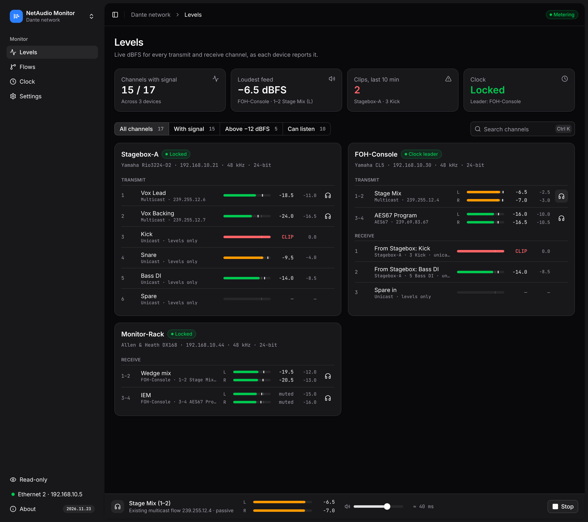
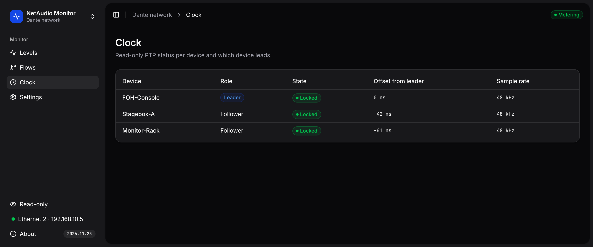
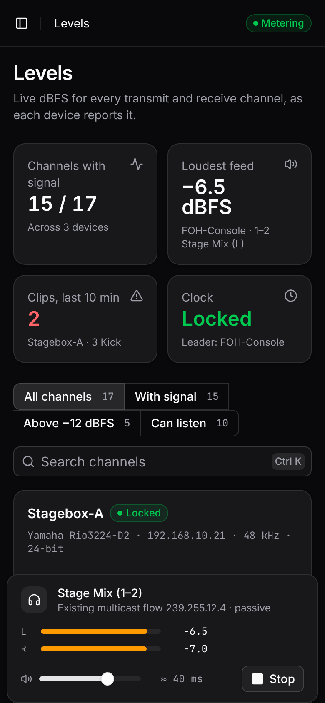

<div align="center">

# NetAudio Monitor

**Live Dante levels, without touching the show.**<br>
A read-only meter for every channel on your Dante network, with live listening to multicast and AES67 feeds.


[](LICENSE)

[Features](#features) ·
[Roadmap](#roadmap) ·
[Docs](docs) ·
[Mockup](docs/mockup)

</div>

> [!NOTE]
> **Being rebuilt from scratch in C++, so there is nothing to download yet.** The design and plan are in the [spec](docs/SPEC.md). The images below are the design [mockup](docs/mockup), not the running app.
> **Unofficial:** built on the open-source [NetAudio](https://github.com/chris-ritsen/network-audio-controller) daemon, not affiliated with or endorsed by Audinate. “Dante” is a registered trademark of Audinate Pty Ltd.

<p align="center">
  
</p>

## Features

| | |
|---|---|
| 📊 **Real dBFS levels** | Every transmit and receive channel, as each device's own meters report it, with peak hold and **CLIP**, muted and no-signal states. Stereo pairs show as one row with L and R. |
| 🎚️ **Clear meters** | A −60 to 0 dBFS scale: green below −12, amber to −3, red above. |
| 🎧 **Listen live** | Feeds that are already **multicast** or **AES67** can be heard by joining them, like any other listener. |
| 🔒 **Read-only by design** | Never creates or removes routing, subscriptions or flows, and never changes a device setting. Unicast feeds are levels only. |
| 🤝 **Beside Dante Controller** | Its own private daemon and metering port, so it stays out of the way. |
| 🕒 **Clock at a glance** | Who the clock leader is, and whether every device is locked. |
| 🧪 **Demo mode** | Simulated devices, levels and audio, to try it with no Dante gear. |

<table>
  <tr>
    <td width="30%"></td>
    <td width="30%"></td>
    <td width="30%"></td>
    <td width="10%"></td>
  </tr>
  <tr>
    <td align="center"><sub><b>Flows</b></sub></td>
    <td align="center"><sub><b>Clock</b></sub></td>
    <td align="center"><sub><b>Settings</b></sub></td>
    <td align="center"><sub><b>Phone</b></sub></td>
  </tr>
</table>

## How it works

```
 NetAudio Monitor  (native C++ · Dear ImGui)
        │   read-only HTTP + live event stream (localhost)
        ▼
 netaudio-daemon  (bundled, private mode)  ──►  Dante devices: meter values only
        │
        └─ listening: joins existing multicast / AES67 groups  ◄──  audio
```

- **Levels** come from the devices' own meters, the same values Dante Controller reads.
- **Listening** joins a multicast group that already exists. No device is asked to send anything new.
- **The app's client can only read.** It contains the read endpoints plus meter start and stop, and a test fails the build if anything else appears.

## Platforms

| | Windows | Linux |
|---|---|---|
| **OS** | Windows 10 22H2+ / 11, x64 | x86_64, e.g. Ubuntu 22.04+, X11 or Wayland |
| **Graphics** | DirectX 11 | GLFW + OpenGL 3.3 |
| **Audio out** | WASAPI | PipeWire / PulseAudio / ALSA |
| **Package** | Installer + portable `.zip` | `.deb` + AppImage |

## Roadmap

| | |
|---|---|
| **Now** | **Phase 0, foundation:** CMake and CI on Windows and Linux, the bundled daemon, checks on real Dante hardware. |
| **Next** | **Core** (read-only daemon client, meter feed, flow map, demo source), then the **Levels, Flows, Clock and Settings** screens as in the mockup. |
| **Later** | **Listening** (multicast and AES67 receive, jitter buffer, playback), then the **release**: Windows installer, `.deb` and AppImage, signed builds. |

Full roadmap: [`docs/ROADMAP.md`](docs/ROADMAP.md).

## Documentation

- [Spec and phased plan](docs/SPEC.md)
- [Roadmap](docs/ROADMAP.md)
- [Mockup](docs/mockup), a clickable shadcn/ui design reference

## Credits

- **[NetAudio](https://github.com/chris-ritsen/network-audio-controller)** by chris-ritsen: the daemon and all of the Dante protocol work this app is built on. Go star it.
- **Dante** and **[Audinate](https://www.getdante.com)**: the audio-over-IP technology behind it all. Dante® is a registered trademark of Audinate Pty Ltd.
- **[Dear ImGui](https://github.com/ocornut/imgui)**, **[miniaudio](https://miniaud.io)**, **[nlohmann/json](https://github.com/nlohmann/json)** and **[GLFW](https://www.glfw.org)**.
- **Made with the help of machines.** Designed and written with the help of AI ([Claude](https://www.anthropic.com), by Anthropic), under human direction and review.
- **[The Tyler Woodward Project](https://tylerwoodward.me)**: direction, testing and the app itself.

## Licence

[MIT](LICENSE). The bundled `netaudio` daemon is a separate project released into the public domain under the [Unlicense](https://unlicense.org).
